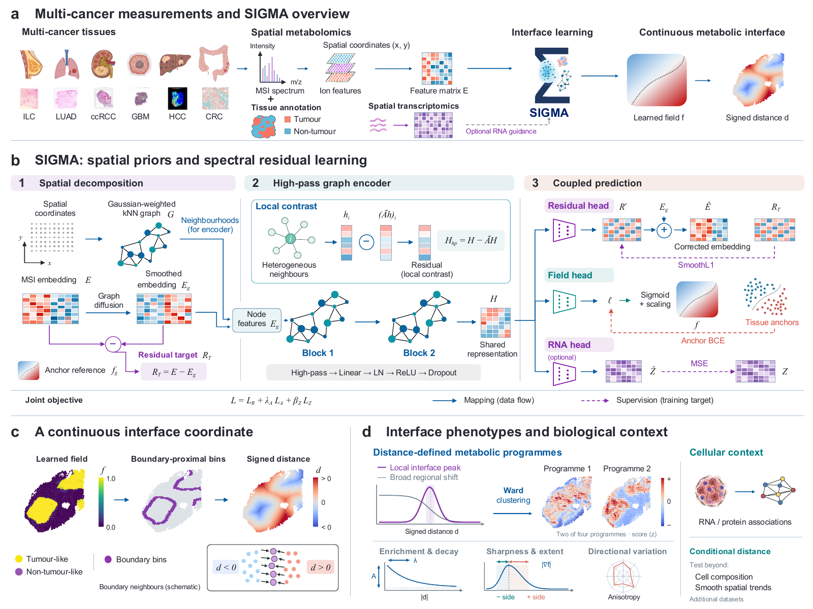

# SIGMA

SIGMA identifies metabolic programmes around tumour interfaces using spatial MSI,
tissue anchors and, when available, matched RNA. It describes where signals change,
their spatial extent and differences along the interface.

[](https://pypi.org/project/sigma-omics/)



[Figure 1 (PDF)](docs/figures/Figure1.pdf)

## Install

Use Python 3.11 in a separate environment:

```bash
python -m pip install "sigma-omics==0.3.2" jupyterlab
```

Import the package as `sigma_spatial`. See [installation](docs/installation.md).

## Run

Prepare aligned MSI, coordinates, anchors and the RNA representation as described
in the [input guide](docs/input_format.md).

```python
import scanpy as sc
from sigma_spatial import run_sigma, run_downstream_analysis

adata = sc.read_h5ad("sample.h5ad")
result = run_sigma(adata, distance_mode="continuous", random_state=0)
report = run_downstream_analysis(
    result, output_dir="results/sample", matrix_source="X", random_state=0,
)
```

Without matched RNA, use the [weak-anchor workflow](examples/weak_anchor_usage.py).
For a small installation check, run [the synthetic example](examples/synthetic_demo.py).

## Section notebooks

After cloning or downloading this repository:

```bash
jupyter lab notebooks
```

The notebooks open saved programme maps, molecular members and distance profiles.
Small result files are included. Recalculation requires the full fitted AnnData
file; [notebook instructions](notebooks/README.md) explain the two modes.

| Section or analysis object | Related figure | Notebook |
|---|---:|---|
| BC515 S1 · breast cancer | 3 | [Open notebook](notebooks/01_BC515_S1.ipynb) |
| BC515 S2 · breast cancer | 3 | [Open notebook](notebooks/02_BC515_S2.ipynb) |
| BC525 · breast cancer | 3 | [Open notebook](notebooks/03_BC525.ipynb) |
| HCC P1 | 4 | [Open notebook](notebooks/04_HCC_P1.ipynb) |
| HCC P4 | 4 | [Open notebook](notebooks/05_HCC_P4.ipynb) |
| Y27T · clear cell renal carcinoma | 4 | [Open notebook](notebooks/06_ccRCC_Y27T.ipynb) |
| CRC B_2 · colorectal cancer | 5 | [Open notebook](notebooks/07_CRC_B_2.ipynb) |
| CRC C_2 · colorectal cancer | 5 | [Open notebook](notebooks/08_CRC_C_2.ipynb) |
| LC091 · lung cancer | 5 | [Open notebook](notebooks/09_LC091.ipynb) |
| LC276 · lung cancer | 5 | [Open notebook](notebooks/10_LC276.ipynb) |
| Glioma574 · IDH-mutant cohort | 6 | [Open notebook](notebooks/11_Glioma574.ipynb) |
| SMINT P1 · IDH-mutant astrocytoma | 6 | [Open notebook](notebooks/12_SMINT_P1.ipynb) |
| 248T · glioblastoma | 6 | [Open notebook](notebooks/13_GBM.ipynb) |

## Data sources

The [data source table](docs/reference_data.md) links each cancer dataset to its
original paper and download archive, including Dataverse, OMIX, Figshare,
BioImage Archive and the relevant processed-data repositories. Each section
notebook also lists its source.

Raw data and full fitted objects are obtained separately. The included notebook
files are saved results, not full reproductions of every manuscript panel.

## Documentation

- [Analysis instructions](docs/running.md).
- [Continuous distance and near/far fixes](docs/continuous_distance.md).
- [Clean-install test results](docs/installation_test_0.3.2.md).
- [Issues](https://github.com/Elsa-bingxue/SIGMA/issues).
